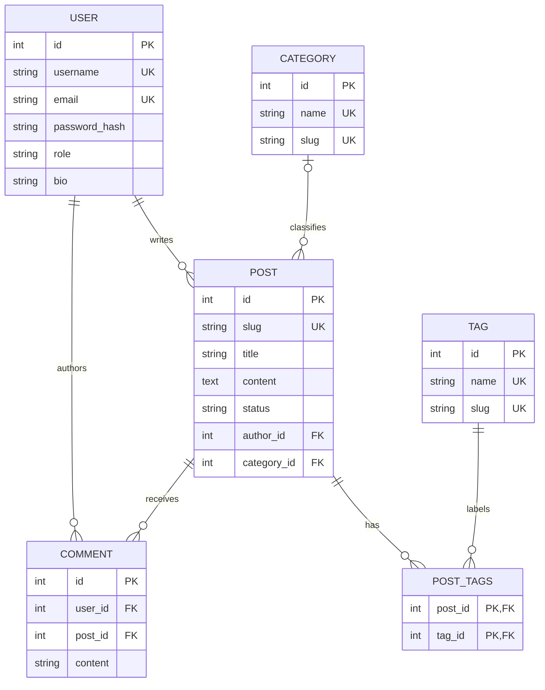

# BlogSphere Structure and Architecture

## Directory tree

```text
.
├── app/
│   ├── __init__.py
│   ├── extensions.py
│   ├── admin/
│   ├── auth/
│   ├── blog/
│   ├── comments/
│   ├── dashboard/
│   ├── notifications/
│   ├── models/
│   ├── static/
│   │   ├── css/
│   │   ├── js/
│   │   └── uploads/
│   ├── templates/
│   │   ├── admin/
│   │   ├── auth/
│   │   ├── blog/
│   │   ├── dashboard/
│   │   └── errors/
│   └── utils/
├── migrations/
├── tests/
├── config.py
├── run.py
├── wsgi.py
├── requirements.txt
├── Dockerfile
└── docker-compose.yml
```

## Architecture

- `create_app()` in `app/__init__.py` builds and configures the Flask instance, initializes extensions, registers feature Blueprints, provides navigation context, and installs error handlers and the admin-creation CLI command.
- `config.py` separates development, test, and production settings. Production requires `SECRET_KEY`; secret values are supplied through environment variables.
- `app/extensions.py` owns shared SQLAlchemy, Flask-Migrate, Flask-Login, and CSRF objects.
- Blueprints divide URL handling by feature: authentication/profiles, public blog/editor, comments, author dashboard, and admin studio.
- `app/blog/scheduling.py` provides an idempotent scheduled-publishing service exposed through a Flask CLI command; an external scheduler invokes it.
- The notifications Blueprint provides an authenticated inbox and read-state actions.
- `app/models/` defines users, articles, categories, tags, nested comments, revisions, likes, bookmarks, reports, notifications, and daily view events.
- `app/templates/` holds reusable Jinja layouts and pages. Static CSS and JavaScript provide styling and editor/form behavior.
- `migrations/` contains Alembic schema history. `tests/` contains isolated pytest integration tests.

## Blueprint and request flow

The WSGI server imports `wsgi:app`, which imports `run.py` and calls the application factory. Flask routes dispatch to a Blueprint view; forms validate submitted fields and CSRF tokens, ORM operations persist data, and Jinja renders the response. Authentication-protected handlers rely on Flask-Login. Owner/admin checks run before editing or deleting content.

## Authentication and publishing flow

Registration validates a username/email and a minimum-length password; Werkzeug stores a one-way password hash. Flask-Login manages signed sessions. Article forms bind to the logged-in user, validate selected category/tag IDs, create a unique slug, optionally save a constrained image upload, sanitize rich-text HTML using Bleach, and convert scheduled local times to UTC. Public listings and details only expose published content; the author and administrators can preview/manage drafts and restore prior content revisions. The `publish-scheduled` CLI command publishes due articles and can be run by an external scheduler.

## Search and filtering

The article listing builds a SQLAlchemy query for published posts, optionally applies case-insensitive title/content matching, category and tag criteria, and a validated newest/oldest sort. Pagination runs on the resulting query, preserving query and filter values in navigation.

## Database relationships



## Factory rationale

The factory pattern allows independent configuration instances for development, test, and production, supports isolated test databases, and avoids binding extension instances to a single global Flask app. Database models are imported during factory setup so Flask-Migrate can discover their metadata.

## Notes

Upload files are stored separately from database rows; production must use persistent storage and backups. CDN-loaded Bootstrap, Quill, and font assets require network access unless self-hosted.

Article view analytics count a pseudonymous cookie once per article per UTC day. The stored visitor key is HMACed with the application secret; IP addresses are not collected. In-app notifications, article revision history, likes/bookmarks, comment replies/reports, RSS, sitemap, and robots output are implemented in their respective blueprints and templates. Scheduled publishing requires an external recurring invocation of the CLI command rather than an in-process worker.
